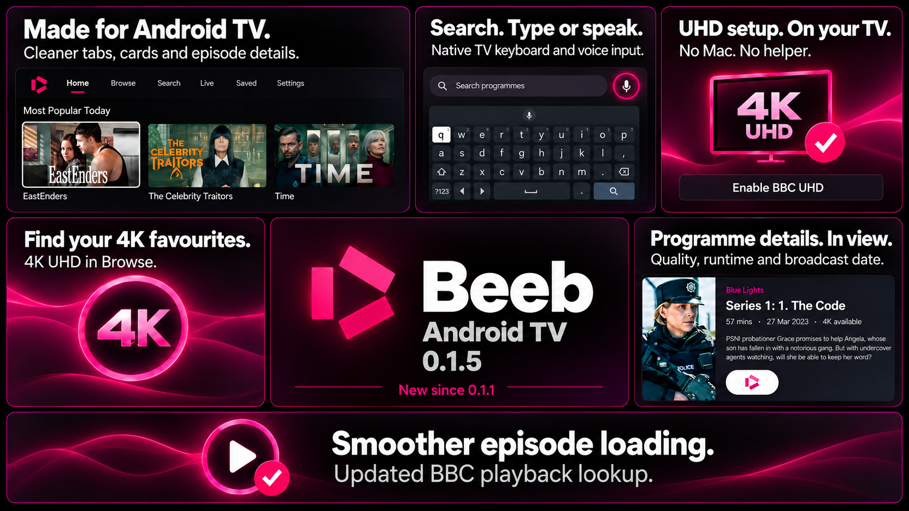

# Beeb for Android TV — 0.1.6

An independent native BBC player for Android TV and Google TV. Android 8.0 (API 26) or later. Beeb is not affiliated with or endorsed by the BBC.

## Features

- Remote-friendly Home, Browse, Search, Live, Saved and Settings screens, using native Android views with visible focus outlines.
- Homepage features and popularity rows; banners prefer artwork without show logos. Episode cards prefer their individual stills.
- Categories, A–Z pagination, series selection and ordered episode pages.
- Programme bookmarks and local Continue Watching, Resume, Start over and Up next. Long-press a history card to remove it.
- Automatic HD selection and optional direct UHD DASH playback on HLG-capable devices. No tvOS DASH-to-HLS server is used.
- Media3 playback, native subtitle selection/rendering, Android caption styling and optional temporary captions on 10-second rewind.
- Version-matched BBC Skip intro / Skip recap actions, when metadata is supplied.
- Received-quality label: 4K HDR requires 2160p video and HDR transfer signalling from the decoder format. A catalogue badge is only an availability hint, not proof of output quality.
- Automatically configures the app for UHD playback: open **Settings → Enable BBC UHD**. No computer helper is needed.

## Download and install

**[Download Beeb for Android TV 0.1.6 — Hotfix](https://github.com/usefulappmaker/beeb-android/releases/tag/v0.1.6)** — signed APK, source and release notes.

Installed as an in-place update and launched successfully on a **Chromecast with Google TV**. Full testing details and remaining device checks are in [VALIDATION.md](VALIDATION.md).

### New in 0.1.6 — Hotfix

- **Live TV subtitles:** added a selectable English subtitle track where BBC captions are available.
- **Native caption appearance:** Android caption settings now control subtitle size, font and colours.
- **Search:** moved catalogue searching into the background to prevent freezing while typing.
- **Episode descriptions:** long descriptions scroll within a shorter area, keeping the Play button clear.
- **UHD compatibility:** Settings and playback quality details explain device limitations that can cause Full HD fallback.


### Changes in 0.1.5



- Refreshed navigation, programme cards, episode panels and bookmark controls.
- Full-catalogue Search with the native TV keyboard and system voice input.
- Redesigned Browse with a dedicated 4K UHD collection.
- Updated BBC episode lookup for more reliable playback.
- Automatic UHD configuration directly on your TV.
- Various UI fixes.

See the [full release notes](CHANGELOG.md).

Use the supplied `Beeb-Android-0.1.6.apk`. You do not need Android Studio or a Google Play developer account to install an APK on a device that permits sideloading.

1. Transfer the APK to your Android TV/Google TV using your chosen local file-transfer method, or use ADB below.
2. If using a file manager, enable “Install unknown apps” for that installer when Android asks. Only approve an APK you intend to install. Device/vendor restrictions vary.
3. Install and open **Beeb** from the TV apps launcher. It includes a TV launcher banner and requires no touch screen.
4. Try HD playback first. Optional UHD setup is described in [SETUP-UHD.md](SETUP-UHD.md).

ADB installation, after enabling and authorising your device's USB/network debugging connection:

```sh
adb devices
adb install -r Beeb-Android-0.1.6.apk
adb shell am start -n org.beebplayer.android/.MainActivity
```

Pairing/connection commands depend on the TV OS and manufacturer. Use Android Studio's device pairing flow or the device's displayed wireless debugging address and pairing code. Keep debugging on a trusted local network.

This is not a Play Store release. Updates must be signed with the same Android key to install over the existing app. A differently signed self-build requires a different application ID or uninstalling the previous build, which removes its local app data. Unlike free Apple provisioning, Android APK signing does not need weekly renewal.

## Controls

- On the focused homepage banner, Left/Right changes the featured programme; OK opens it. Artwork uses a taller frame, capped to fit the TV screen.
- Playback controls fade after 1.5 seconds during playback.
- D-pad: move focus. Centre/OK: select. Back: return to the previous page or leave playback.
- Playback uses Media3's default controls, timeline, settings and subtitle interface.
- The small quality badge reports received resolution and HDR/HLG. Programme metadata shows title, episode, length, broadcast date and description where supplied. Select the metadata for the full description.
- Press OK to reveal controls. Back dismisses visible controls during playback; Back again leaves the player. Pause keeps the standard controls visible.
- The episode dialog's Play action is logo-only, with an accessible Play label.
- The standard rewind button rewinds and temporarily enables English captions if they were Off and a supported track is present. Dedicated remote Rewind does the same. Left also rewinds when the native controls are hidden; when controls are visible it remains available for normal focus/scrubbing navigation.
- Temporary captions restore the prior selection after playback reaches the pre-rewind position. Changing the native subtitle selection manually cancels that automatic restoration.
- Settings lets you disable captions on rewind and open Android's caption appearance settings.
- Skip intro/recap appears only during a supplied interval for the actual playing BBC version.

## Live channels on TV home

Open Beeb Settings and select **Add live-channel cards to TV home**. Allow the row if your launcher asks, then enable/reorder **Beeb · Live channels** in its home-channel settings. The landscape cards show current programme artwork; selecting one opens that channel directly, without an episode dialog. Programme cards refresh periodically while the device is online.

This uses the Android TV home-channel API. The TV launcher controls visibility and placement; some Google TV launchers do not expose third-party rows. It cannot guarantee Apple TV’s “press Up from the app icon” Top Shelf behaviour. The Live tab inside Beeb remains available on every supported device.

## Build from source

Install Android Studio with the Android SDK Platform 37, Build Tools 36/37 and Platform Tools. Use Android Studio's bundled Java runtime (tested with Java 25); Gradle Wrapper 9.1.0 and Android Gradle Plugin 9.0.1 are pinned. Compile SDK is 37; target SDK is 36. Dependencies come from Google Maven and Maven Central.

Open this folder in Android Studio and let Gradle sync. Or on a Mac with the default Android Studio/SDK locations:

```sh
chmod +x build.sh gradlew setup-uhd.command
./build.sh assembleDebug testDebugUnitTest lintDebug
```

Override `JAVA_HOME` and `ANDROID_HOME` for a different installation. On other systems use the Gradle Wrapper directly after setting these variables. The debug APK is `app/build/outputs/apk/debug/app-debug.apk`, installed separately as **Beeb Preview** (`org.beebplayer.android.debug`) so testing does not overwrite a release installation. No signing account is required for a debug build.

For your own signed release, create and securely retain an Android signing key, then set these environment variables privately:

```text
BEEB_KEYSTORE_PATH       absolute path to your keystore
BEEB_KEYSTORE_PASSWORD   your keystore/key password
BEEB_KEY_ALIAS           alias (default: beeb)
```

Run `./build.sh assembleRelease`. Without those variables, `assembleRelease` produces an unsigned APK. Do not commit the key, password or a machine-specific `local.properties` file. Beeb does not include any maintainer signing key.

## Limits and verification

See [VALIDATION.md](VALIDATION.md) for completed tests and unresolved device checks. An emulator cannot establish physical 4K HLG output. Optional UHD requires an identity accepted by BBC, a capable HEVC decoder, HLG display path and currently available BBC content. Direct setup checks the downloaded identity before saving it; availability of the upstream configuration and BBC service can change.

No BBC account/profile sync, offline programme downloads, Chromecast integration or Android TV system-wide watch-next integration is implemented. Continue Watching is inside Beeb. No telemetry or account login is added. The app accesses BBC/CDN services and the UHD configuration source when you select Enable BBC UHD. BBC availability and network restrictions still apply.

The source and APK are separate deliverables. Public source packaging excludes Gradle caches, test reports, device captures, local paths, setup credentials and signing keys. Reused branding and your publishing account can still connect projects; this is not an anonymity guarantee.

GPL-3.0-or-later, with upstream attribution and dependency licensing in [NOTICE.md](NOTICE.md).

## Browse and Search

Browse uses unboxed category labels and an A–Z row, matching the main interface. Its **4K UHD** collection starts with the same 95 known titles as the tvOS catalogue; availability varies by episode. Opening programmes can discover additional UHD titles.

The **Search** tab searches programme titles and descriptions across the full bundled catalogue, including programmes never opened before. The index refreshes from BBC’s complete A–Z catalogue when older than a day; **Refresh catalogue** also updates it manually. Interrupted or incomplete updates retain the saved catalogue.

Select the search field to use the installed Android TV keyboard. The microphone button launches the installed system speech recogniser and uses the returned words as the query. Voice support depends on the TV’s installed recogniser and microphone; keyboard entry remains available. Beeb does not request microphone permission or implement its own audio recorder.

Season selectors display the generic “Episodes” group as **Specials**, while all named seasons retain their original names and grouping.

Playback version discovery uses BBC’s current episode API for both HD and UHD. It matches the requested episode, excludes expired/future, signed and audio-described versions, and prioritises available UHD versions. The obsolete programme playlist endpoint is no longer used.

## Live subtitles and caption appearance

Where BBC supplies live captions, the player’s standard subtitle menu offers **English**. Beeb maps BBC’s numbered TTML fragments to the live video clock and exposes a rolling WebVTT rendition to Media3. Video and audio are streamed directly without transcoding. Caption fragments are requested as needed, including within the available rewind window. Temporary gaps in BBC captions can leave a quiet interval; some channels/programmes do not supply captions.

Android’s caption appearance settings control colour, background, typeface and relative size. Beeb ignores the BBC file’s embedded colours/font sizes, and applies changes while the player is open or after returning from system Settings. Manual subtitle selection remains in the standard player menu; the existing temporary-captions-on-rewind behaviour is retained.

## Full HD on a UHD programme

A catalogue UHD badge means availability, not a guarantee that every device can decode and output that version. BBC UHD requires **HEVC Main 10 and HLG**. HDR10 and Dolby Vision support alone do not establish HLG support. Settings and the player’s received-quality details explain the capability gate reported by Android. Network conditions, available episode versions and decoder errors can also lead to HD playback.

NVIDIA’s [Shield specifications](https://www.nvidia.com/en-eu/shield/shield-tv/) list HEVC 4K, HDR10 and Dolby Vision. Do not assume HLG compatibility from those specifications. Android recommends [checking the reported HLG display capability](https://developer.android.com/media/grow/hdr-playback). A Shield/display/receiver setup needs its own capability report to confirm the cause. Beeb retains the compatible HD fallback; it does not relabel HLG as HDR10 or convert colour formats.
